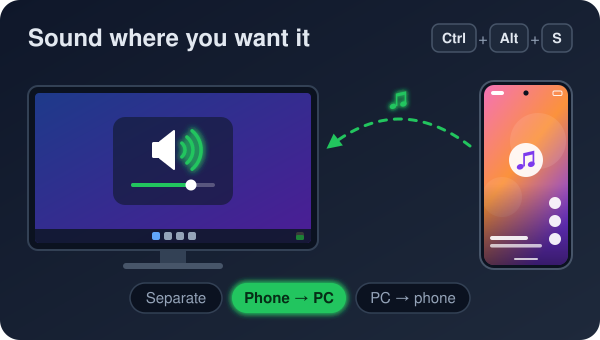
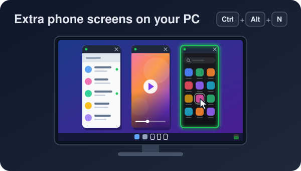
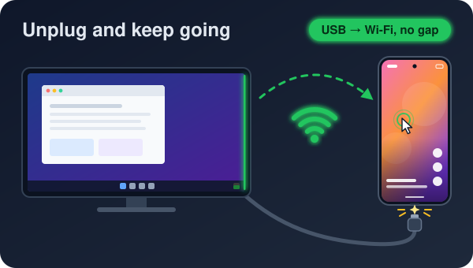
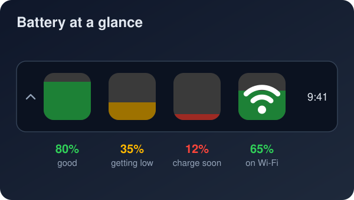

# PhoneEdge

Push your mouse past the edge of your PC screen → it controls your Android phone.
Your phone sees a **real USB mouse + keyboard** (its own native cursor, hover, right-click, scroll, text selection).
No app on the phone. Works over **USB** (best) and **Wi-Fi** (automatic fallback).

Like Apple's Universal Control, but for a Windows PC and an Android phone. Also: phone sound on the PC (or PC sound
on the phone), extra phone screens in PC windows, clipboard both ways, battery in the tray.

  
  
  
  

**Status:** a personal project, used daily and tested on a **Honor Magic V3 (Android 16, MagicOS)** with
**Windows 11**. Other Android phones should work the same way (it only uses standard Android features over USB
debugging), but haven't been tested yet. Reports welcome.

**Needs:** Windows 10/11 (x64), an Android phone with USB debugging, the
[.NET 8 Desktop Runtime](https://dotnet.microsoft.com/download/dotnet/8.0) (only for the small download; the bundled
one includes it). Everything else comes with PhoneEdge, including [scrcpy](https://github.com/Genymobile/scrcpy) 5.0.1
for the phone screen window, extra phone windows and phone sound on the PC.

---

## One-time setup

**On the phone (Honor / Android 11+)**
1. Settings → About phone → tap **Build number** 7× → enter PIN.
2. Settings → System & updates → **Developer options** → turn on **USB debugging**.
   (Also **"Allow ADB debugging in charge only mode"** if you see it.)
3. Plug the phone into the PC with a **data** cable → tap **Allow** (tick "Always allow from this computer").

**Typing in two languages, e.g. Arabic + English (once)**
1. Click the PhoneEdge tray icon → **Settings** → *Mouse & keyboard* → **Phone keyboard languages: Open on phone** (opens the phone's *Physical keyboard* page).
2. Tap **PhoneEdge Keyboard** → add **English (US)** and **Arabic**.
3. Switch language while controlling the phone with **Win+Space** or **Alt+Shift** (same as Windows).

**On the PC**
- **Download** from [Releases](https://github.com/Reo-Trawndres/PhoneEdge/releases/latest):
  - **`PhoneEdge-…-Setup.exe`** (~50 MB, .NET included): run it, done. Start menu shortcut, starts with Windows,
    uninstall in Settings → Apps; no admin needed. **Not sure? Take this one.** It also updates an older PhoneEdge.
  - `…-bundled.zip` (~70 MB, .NET included) or `…-win-x64.zip` (~5 MB, needs the .NET 8 Desktop Runtime; if it's
    missing, Windows says so and offers to download it): unzip anywhere you like to keep it (e.g. Documents) and run
    **PhoneEdge.exe**. Click the tray icon → **Settings** → *General* → **Start with Windows** to have it start by
    itself.
- **"Windows protected your PC"?** PhoneEdge isn't code-signed yet (a signing certificate costs money), so Windows
  SmartScreen warns about any new download from an unknown publisher. Click **More info → Run anyway**.
- PhoneEdge checks GitHub once a day for a newer version and says so in the tray (Settings → *General* → *Tell me about new versions*
  turns it off; it sends nothing about you or your phone).
- Open it any time from the Start menu / desktop (**PhoneEdge**). Opening it while it runs just shows its status.
- No admin needed.

**No app on the phone.** Any Android phone with USB debugging works the same way (best on Android 15/16; on older
Android the return-to-PC edge may need a slightly firmer push).

## Every day

- PhoneEdge starts with Windows and waits in the tray. **Nothing to click.**
- **Phone plugged in** → connected in ~2 s. **Not plugged in** → it connects over Wi-Fi by itself.
- **PC was asleep / restarted** → it reconnects on its own.
- **Phone restarted** → plug the cable in once, **or** turn on **Wireless debugging** on the phone (Developer options,
  or search "Wireless debugging" in Settings): PhoneEdge finds the phone on Wi-Fi by itself. (Android switches Wi-Fi
  debugging off on every restart.)
- Locked phone? Move the mouse over, type your PIN with the PC keyboard.

---

## Daily use

| Do this | Result |
|---|---|
| Push the mouse past the **right** edge of the screen | Mouse + keyboard now control the phone |
| Move the phone cursor back to its **left** edge and keep pushing | Back to the PC, at the matching height |
| **Ctrl+Alt+Q** | Toggle PC ↔ phone. Always works, even if something goes wrong |
| Click the tray icon (left or right) | The **PhoneEdge panel**: phone, battery and connection at a glance; buttons to control the phone, show its screen, open a phone window, turn its screen off; sound mode; Pause; Settings |
| Copy on one side | Paste on the other (text clipboard sync) |
| **Ctrl+Alt+M** | Show / hide your **phone screen in a window on the PC** (live, clickable, stays on top) |

While you're on the phone, a **green bar glows on the phone-side edge of every PC screen**, and a small **"Phone"** tag
shows for a moment where you crossed. **On the phone, the mouse pointer pulses** (grows and shrinks) when it arrives.
When the phone connects, its cursor briefly appears on its left edge (PhoneEdge is learning exactly where it is,
so every crossing afterwards is one smooth move).

- **Phone mouse speed** is separate from your PC: Settings → *Mouse & keyboard* → **Phone mouse speed** (0.4× … 2×).
- **Ctrl + scroll = zoom** on the phone (a two-finger pinch around the cursor): maps, photos, web pages.
- **Smooth scrolling** for touchpads and high-resolution wheels (no more notch-sized jumps). A normal wheel keeps
  the phone's own wheel feel.
- **Right-click = Back** on the phone. Need a real right-click (context menu)? **Shift + right-click**.
- **No accidental side-swipe Back:** clicks in the phone's ~4 mm edge-gesture strip (left/right) work normally
  and don't jump. Only if you press there and start dragging does the cursor step just outside the strip, so the
  drag can never turn into a Back swipe. (Press and hold still 0.4 s = long-press where you are.)
- **Clipboard:** copying on the PC no longer pops up Android's "Edit / Share" preview on the phone.
- **Volume keys / knob** change the volume of the speakers you're hearing: the phone while you're on it (or whenever
  PC sound plays on the phone), the PC otherwise.
- **Wispr Flow (or another PC dictation app) on the phone:** while you're on the phone, its shortcuts still reach it
  (hold **Ctrl+Win**, or the mouse side buttons), and the text it pastes is pasted **on the phone** instead.
  Setting `PcShortcutsOnPhone` (default `Ctrl+Win, MouseX1, MouseX2`).
- **Enter = send in chats:** that's the app's own setting. WhatsApp → Settings → Chats → **Enter is send**.

**Phone screen on the PC** (Ctrl+Alt+M or the panel's **Phone screen** button): a live window of the phone, using the
scrcpy app that comes with PhoneEdge. Click and type in it like on the phone. It stays open (and on top) until you press
Ctrl+Alt+M again or close it; if you unplug the cable it reopens over Wi-Fi by itself. It opens exactly as tall as
your main screen (top to the taskbar) and exactly as wide as the phone picture (no black bars).
Options in Settings → *Phone screen*: open on the **right / in the middle / on the left** of the screen
(moves right away if it's open), keep on top, turn the phone's own screen off while shown.

**More phones: new phone windows** (**Ctrl+Alt+N** or the panel's **New window** button): each press opens an extra, virtual
phone screen in its own PC window, like a second phone: pick any app from the app grid (or search: type + Enter).
The real phone keeps showing what it was showing. Windows open full height, side by side. The small **Apps** button at
the bottom of a window opens another app there. Settings → *Phone screen* → **Big phone screen** opens one big tablet-size window.
Notes: an app can only be in one place at a time (opening it moves it); closing a window closes the apps in it;
banking/streaming apps may show black. Typing uses a real Android keyboard: for Arabic, set its layouts once (Settings →
*Mouse & keyboard* → *Phone keyboard languages*, the "scrcpy" keyboard). Windows close by themselves when PhoneEdge closes.

**Phone's own screen off** (**Ctrl+Alt+O** or the panel's **Screen off** button): only the screen panel goes dark; the phone keeps running and
stays awake (phone windows, sound and control keep working) and it saves the most battery. It comes back on when
your mouse goes onto the phone. Optional (off by default): Settings → *Phone screen* → *Turn the phone's screen off while phone windows
are open*. Don't use the power button for this: that locks the phone.

**Sound** (the panel's Sound buttons, or **Ctrl+Alt+S** to cycle; a small label at the bottom of the screen says which):

| Mode | What you hear |
|---|---|
| Phone and PC sound separate | Each plays its own sound (default) |
| Phone sound → PC speakers | The phone goes silent; its sound plays on the PC (uses the built-in scrcpy, no window) |
| PC sound → phone | The PC is muted; everything it plays comes out of the phone (or its headphones). Small delay (~0.1 s on USB) |

PhoneEdge always unmutes the PC when you leave "PC sound → phone", quit, or if it crashed (at the next start).

**Battery:** while connected, the tray icon is a rounded tile that **fills up like a glass** with the phone's charge
(green ≥ 50%, amber 20–49%, red < 20%; all grey = paused). It's clean on USB; a **Wi-Fi sign** appears on it while
the link runs over Wi-Fi (e.g. the cable dropped). Warnings at 15% and 5%. Hover for the exact % and full status.

No phone connected: the tray icon is a **grey** phone.

Phone on the other side? Settings → *Mouse & keyboard* → **Where your phone is** → Left / Right / Above / Below.

---

## Voice and AI (optional)

Everything here is off until you download it in Settings → *Voice & AI*, and it runs **on your PC**: what you say
isn't sent anywhere (unless you pick "My own AI" with a cloud service, below).

- **Voice commands:** hold the talk key and say what you want, in English, Arabic or both: open apps, play music,
  routines. **Speech model** → *Download* (Whisper, from Hugging Face).
- **Cohere Arabic (experimental):** a speech model that understands Iraqi Arabic with English mixed in, for a graphics
  card with 4 GB or more: Settings → *Voice & AI* → *Speed or accuracy* → **Cohere Arabic** → *Download* (2.4 GB: the
  model, its engine and two small helpers, from their makers on Hugging Face and GitHub, no sign-in). Voice keeps using
  the usual model until the download is done.
- **AI brain:** understands normal sentences and does several things at once ("open Discord and put it on the left").
  **Light** (about 2 GB), **Standard** or **Best** (strong graphics cards) → *Download* (llama.cpp's llama-server and
  the model, from their makers). It opens or closes only the apps you named; closing an app, Wi-Fi or Bluetooth off,
  sleep, restart, shut down and sign out always ask first ("yes"). It never deletes files. It leaves the graphics card
  for full-screen games and after 5 minutes idle.
- **Hands:** files and folders, quick PC settings, typing by voice (it sends only when you say "send"), clicking buttons
  by name, app pages, moving a window to another monitor. In apps that show Windows no buttons (like Steam), it can read
  the text of the app in front to find them (Settings → *Voice & AI* → *Understanding*).
- **Hold Right Shift to write** (on once the speech model is there): hold it, talk, let go: your words are typed where
  the cursor is. It never presses Enter and never types into password boxes. Another key or Off: Settings → *Voice & AI*
  → **Hold to write**. Holding Right Shift for 8 seconds is also Windows' own Filter Keys shortcut: for long dictations,
  turn that off in Windows Settings → Accessibility → Keyboard → Filter keys.
- **Voice language:** you're heard in the language your PC's keyboard is set to when you start talking (English or
  Arabic), for voice commands, Hold to write and the phone's mic; a small EN / ع chip shows which. To let PhoneEdge
  guess instead: Settings → *Voice & AI* → **Voice language** → *Detect it*.
- **Recent commands** keeps what it heard (with the sound) and what it did, for 24 hours, on this PC only. Turn it off:
  Settings → *Voice & AI* → *Privacy* → **Keep for 24 hours**. **Memory** ("remember that…"): see and change what it
  knows in Settings → *Voice & AI*.
- **My own AI:** use Claude, Gemini, an OpenAI-compatible service or Ollama / LM Studio instead, with your own key
  (encrypted for your Windows account). With a cloud service, **what you say, your PC's app names and your memory are sent
  to that service**; PhoneEdge shows this before anything is sent. Ollama and LM Studio stay on your PC.

---

## Wi-Fi

- The first time the phone is on **USB**, PhoneEdge enables ADB-over-Wi-Fi (port 5555) and remembers the phone's IP.
- While on USB it keeps a **ready Wi-Fi link**: unplug the cable and you keep controlling the phone with no gap
  (measured: switched in 1 ms). Plug back in → back to USB (your phone restarts its debugging service when you plug
  in, so that direction takes a few seconds). The panel shows "USB · Wi-Fi ready" when the spare link is up.
- After a **phone reboot** (Android turns ADB-over-Wi-Fi off), plug in USB once, or turn on **Wireless debugging**
  (Android 11+): the phone then announces itself on the network and PhoneEdge connects to it by itself. No pairing is
  needed if the PC was already allowed over USB; a phone that never allowed this PC refuses.
- **No taps at all after a restart or a Wi-Fi drop:** Settings → *Phone extras* → Install.
  Everything works without them; with one click PhoneEdge adds the **phone extras** ("PhoneEdge extras" on the phone,
  ~110 KB) over the current USB or Wi-Fi connection and gives them their special
  permissions (switching Wireless debugging, notifications). After a restart, once you unlock the phone, they turn
  Wireless debugging on, but only on the Wi-Fi where PhoneEdge has connected over Wi-Fi before (they remember the
  network's address range, no location access needed), and PhoneEdge reconnects within a minute. Android also switches
  Wireless debugging off each time the phone's Wi-Fi drops, even for a second: the extras keep running quietly (a silent
  notification you can hide) and switch it back on a few seconds after the Wi-Fi is back, and PhoneEdge reconnects by
  itself. They also keep a **live link** to PhoneEdge (adb reverse, both sides prove a secret token), show **"Controlled
  by <your PC>"** with a **Disconnect** button while the PC's mouse is on the phone (Disconnect sends it back and pauses
  PhoneEdge until you resume it on the PC), tell PhoneEdge at once when something is shared to it, add a **Wireless
  debugging** tile for the pull-down panel and a **PhoneEdge** app with their status (connected PC, Wireless debugging,
  home Wi-Fi networks). PhoneEdge updates them when it brings a newer version. Honor/Huawei/Xiaomi stop new apps from
  starting by themselves: PhoneEdge opens the right settings page and says which switch to flip (Honor: Battery → App
  launch → PhoneEdge extras → switch off "Manage automatically" → OK). Remove them from the same card.
- **More with the phone extras (1.5):** **phone notifications on the PC** (PhoneEdge's own cards at the bottom right:
  Reply for chats, Open on the phone, Dismiss; Arabic reads right to left; nothing is kept; skip apps or hide the text
  in Settings → *Notifications*), the **phone as a remote** (PhoneEdge on the phone → *Remote for the PC*: play/pause,
  tracks, the volume in 2 % steps or an exact number, **PC apps you pick** (Settings → *Phone extras* → *Apps on the
  phone*, with their real icons; the phone can only open those), slides, a touchpad (two fingers scroll and
  right-click), Lock the PC, **which output plays the PC's sound** (headphones, speakers, a monitor: for the whole PC or
  one app, also on the widget and by voice); a small chip at the bottom right of the PC confirms each press; nothing happens while the
  PC is locked), **quick settings tiles** (Send to PC, Sound, Phone screen on PC) and a **home-screen widget**. Links
  from the phone can open in a browser of your choice (Settings → *Phone extras* → *Open links from the phone in*).
  "Controlled by" now shows its icon in the status bar, and Settings → *Phone extras* → *On the phone* can hide Android's
  own "debugging connected" notice.
- No cable at all? Settings → *Phone & Wi-Fi* → **Pair a phone** (Android 11+ Wireless debugging), then **Connect by IP address**.

**Smooth Wi-Fi mode** (on by default; Settings → Phone & Wi-Fi): every mouse move goes out at once with its PC time, and
PhoneEdge's relay on the phone replays the moves with their original spacing behind a small delay that adapts to how
bumpy the Wi-Fi is. Android sees USB-like timing: smooth, and the cursor stays exactly where PhoneEdge expects it.
**Wi-Fi feel** chooses the trade-off: *Smoothest* (never stutters, reacts a bit later), *Balanced*, *Fastest* (reacts
sooner, may hitch on a bumpy moment). Measured here (250 moves at 8 ms): all 250 reach the phone evenly, versus ~30 in
the older paced mode.

**Wi-Fi quality matters most.** If the pointer hitches every few seconds, the PC's own Wi-Fi is usually the cause (ping
your router: spikes of 30–50 ms every few seconds). On Intel Wi-Fi cards: Device Manager → Network adapters → your
Intel Wi-Fi → Advanced → **Roaming Aggressiveness: Lowest** (the big one: it stops background scans), **MIMO Power Save
Mode: No SMPS**, **Packet Coalescing: Disabled**. Measured here: router ping spikes 49 ms → 5 ms, PhoneEdge's added
delay ~21 ms → ~3 ms. Even better: PC on **Ethernet**, phone on **5 GHz** near the router.

**Phone drops off Wi-Fi every few minutes on a Wi-Fi 7 router?** Some phones' Wi-Fi 7 (802.11be) links freeze: the
phone can't send for 10–50 s, then its Wi-Fi resets (PhoneEdge and the phone helper bring the connection back, but it
still interrupts). Seen here with a Honor Magic V3 on a Huawei EG8145B7 (7 freezes in 80 minutes, PC on Wi-Fi 6 fine).
Fix: in the router's 5 GHz settings set the mode to Wi-Fi 6 (**802.11a/n/ac/ax**, without "be") and turn off MLO; the
speed stays the same for PhoneEdge and your internet.

Security note: ADB-over-Wi-Fi only accepts PCs the phone already authorised (RSA key), but it is open on your LAN
until the phone reboots.

---

## Settings (`%APPDATA%\PhoneEdge\config.json`, Settings → *General* → Settings file)

| Setting | Default | Meaning |
|---|---|---|
| `PhoneSide` | `Right` | Where the phone sits: Left / Right / Top / Bottom |
| `EdgePushCounts` | 12 | How hard you push into the PC edge before switching (avoids accidental switches at scrollbars) |
| `ReturnPushCounts` | 20 | Same, for the phone edge |
| `CornerGuardPx` | 12 | No switching in screen corners (close buttons) |
| `MouseSpeed` | 1.0 | Phone mouse speed (Settings → Mouse & keyboard). Your PC speed is untouched |
| `ScrollSpeed` | 1.0 | Wheel speed on the phone |
| `EntryEaseMs` | 0 | Optional soft landing after crossing (ms to reach full speed); 0 = off |
| `PhoneIndicator` | true | Pulse the phone pointer on arrival |
| `SmoothScroll` | true | Touchpad / hi-res wheel scrolling sent as fractions of a notch |
| `CtrlScrollZoom` | true | Ctrl + wheel on the phone = pinch zoom around the cursor |
| `WifiStandby` | true | Keep a ready Wi-Fi link while on USB (no gap when unplugging) |
| `CheckForUpdates` | true | Once a day, ask GitHub if a newer PhoneEdge is out (tray note + a banner in the panel) |
| `MirrorHotkey` | `Ctrl+Alt+M` | Show/hide the phone screen window |
| `Sound` | `Separate` | Separate / PhoneToPc / PcToPhone (panel → Sound) |
| `NewPhoneHotkey` | `Ctrl+Alt+N` | Opens a new phone window |
| `ScreenOffHotkey` | `Ctrl+Alt+O` | Phone's own screen off/on (keeps running) |
| `ScreenOffWithPhoneWindows` | false | Phone's own screen off while phone windows are open (mouse on the PC); Settings → Phone screen |
| `PcShortcutsOnPhone` | `Ctrl+Win, MouseX1, MouseX2` | Shortcuts that still go to PC apps while you're on the phone (Wispr Flow) |
| `SoundHotkey` | `Ctrl+Alt+S` | Cycles the sound modes |
| `MirrorPosition` | `Right` | Where the phone screen window opens: Right / Middle / Left of the main screen |
| `MirrorAlwaysOnTop` | true | Phone screen window stays above other windows |
| `MirrorScreenOff` | false | Turn the phone's own screen off while it's shown on the PC |
| `MirrorMaxSize` | 1280 | Phone screen window over Wi-Fi: lowest sharpness (longest side, px; at least the screen's height). On USB it always gets the phone's full resolution |
| `FrameRateUsb` | 0 | Phone screen window and phone windows on USB: at most this many frames per second, 1–240; 0 = Max (no cap). Settings → Phone screen |
| `FrameRateWifi` | 30 | The same over Wi-Fi (0 = Max) |
| `WifiVideoMbps` | 4 | Picture quality over Wi-Fi: video bit rate in Mbps (Low 2, Normal 4, High 8, Max 16) |
| `BatteryWarnPercent` | 15 | Low-battery warning level (plus one at 5%) |
| `RightClickBack` | true | Right-click = Back on the phone (Shift + right-click = normal right-click) |
| `BlockEdgeSwipe` | true | Drags that start in the edge-gesture strip step out of it first (no accidental Back); clicks there don't move |
| `InvertScroll` | false | Reverse wheel direction on the phone |
| `Hotkey` | `Ctrl+Alt+Q` | Toggle / escape |
| `ClipboardSync` | true | Text clipboard both ways |
| `LayoutSwitchKeys` | true | Win+Space / Alt+Shift switch the phone's keyboard language |
| `AlignEntry` | true | Phone cursor appears at the same height where you left the PC screen |
| `AutoWifi` | true | Enable ADB-over-Wi-Fi while on USB |
| `AdbPath` | "" | Custom adb.exe (default: PATH, Android SDK, then the bundled copy) |

Edits to the file apply within a second (no restart needed).

---

## Troubleshooting

- **Gray icon, "Waiting for phone"** → check the cable is a data cable and USB debugging is on; re-plug; tap Allow.
- **"Tap Allow USB debugging"** → unlock the phone and accept the prompt.
- **Mouse stuck on the phone** → **Ctrl+Alt+Q**. (Ctrl+Alt+Del always works too.) Unplugging the phone also returns control.
- **Wrong characters when typing** → set the layouts for *PhoneEdge Keyboard* on the phone (see setup).
- **Can't control admin windows on the PC (Task Manager etc.)** → Windows blocks non-admin hooks there; run PhoneEdge as admin if needed.
- **Finger swipe gestures act strange / the Back indicator is gone (Honor/MagicOS)** → restart the phone. Honor's
  System UI moves the real screen's gesture zones onto any extra screen that has its own navigation bar, and doesn't
  fully rebuild them when it closes. PhoneEdge's phone windows are made without bars so they don't trigger it; plain
  `scrcpy --new-display` does unless you add `--no-vd-system-decorations`.
- Log: Settings → *General* → **Log: Open** (`%APPDATA%\PhoneEdge\phoneedge.log`).

---

## License and credits

PhoneEdge is **free to use** (not open source): see [LICENSE](LICENSE). Versions up to and including 2.0.1 were released
under the Apache License 2.0 ([licenses/Apache-2.0.txt](licenses/Apache-2.0.txt)). Credits are in [NOTICE](NOTICE), and the
third-party licenses are in [licenses/](licenses/) and come with every download.

- [scrcpy](https://github.com/Genymobile/scrcpy) (Apache 2.0): PhoneEdge runs its `scrcpy-server` on the phone for
  the virtual mouse and keyboard, and the helper adapts its way of getting a working Android context.
- [NAudio](https://github.com/naudio/NAudio) (MIT): PC sound capture.
- [Whisper.net](https://github.com/sandrohanea/whisper.net) and [whisper.cpp](https://github.com/ggml-org/whisper.cpp)
  (MIT), with OpenAI's [Whisper](https://github.com/openai/whisper) models (MIT): voice commands, understood on the PC
  (the engine and the models are downloaded when asked, not part of PhoneEdge's download).
- [transcribe.cpp](https://github.com/handy-computer/transcribe.cpp) (MIT), with Cohere Labs' Transcribe Arabic
  (Apache 2.0), [Silero VAD](https://github.com/snakers4/silero-vad) (MIT) and SpeechBrain's VoxLingua107 language ID
  (Apache 2.0): the optional Cohere Arabic speech model (downloaded when asked).
- [llama.cpp](https://github.com/ggml-org/llama.cpp) (MIT), with Ministral 3 3B (Mistral AI), Qwen3 8B (Qwen team) and
  Gemma 4 12B (Google), all Apache 2.0: the AI brain (downloaded when asked).
- [Anthropic C# SDK](https://github.com/anthropics/anthropic-sdk-csharp) (MIT): "My own AI" with Claude (downloaded when
  Claude is first used).

Not affiliated with Google, Honor or the scrcpy project.
